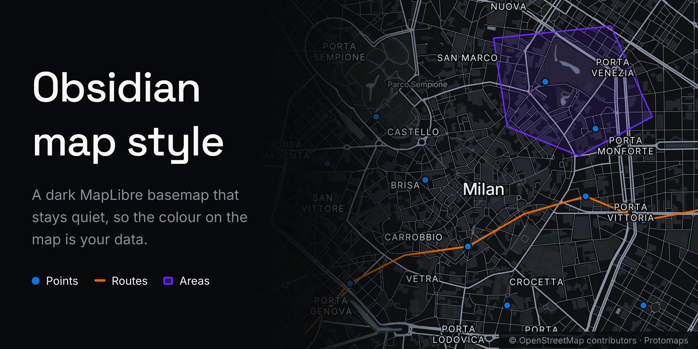
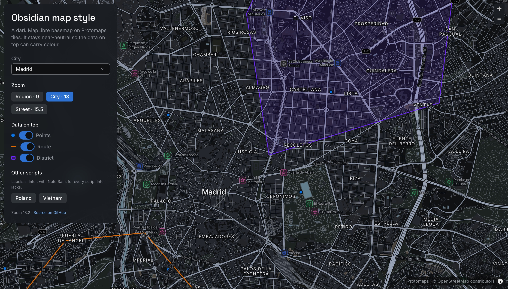
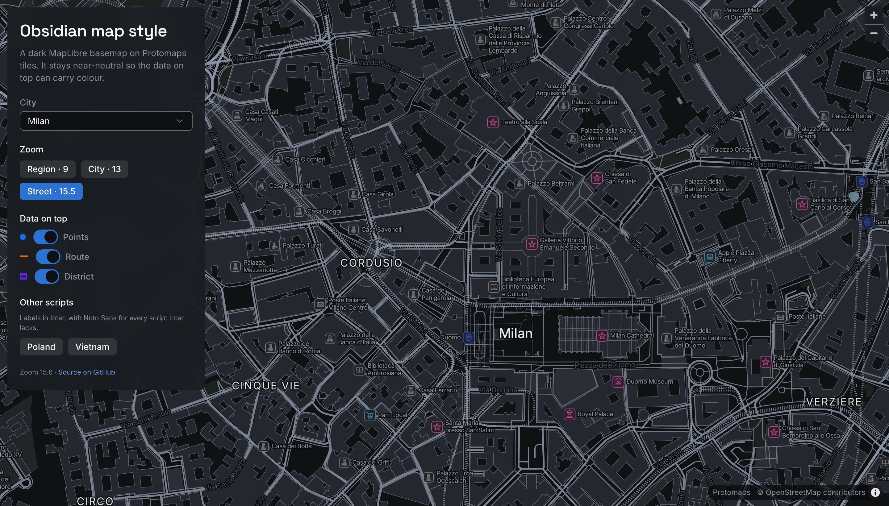

<p align="center">
  
</p>

<h1 align="center">Obsidian map style</h1>

<p align="center">
  A dark basemap style for <a href="https://maplibre.org">MapLibre GL</a> on <a href="https://protomaps.com">Protomaps</a> tiles,<br>
  designed to sit behind data.
</p>

<p align="center">
  <b>Version 0.1</b> · Built on <a href="https://github.com/protomaps/basemaps">Protomaps basemaps 5</a> and <a href="https://maplibre.org">MapLibre GL 5</a>
</p>

<p align="center">
  
  
  
  
</p>

<p align="center">
  <a href="#getting-started"><b>Getting started</b></a> ·
  <a href="#data-on-top"><b>Data on top</b></a> ·
  <a href="#tiles"><b>Tiles</b></a> ·
  <a href="https://github.com/antoniocapo714/astryx-theme-obsidian"><b>Obsidian theme</b></a> ·
  <a href="#ai-assistants"><b>AI assistants</b></a> ·
  <a href="CHANGELOG.md"><b>Changelog</b></a>
</p>

## Overview

A map in a data product has one job: give the data a place to stand. This style keeps the basemap near-neutral and readable, so whatever you draw on top — points, routes, regions, heatmaps — is the most colourful thing on screen.

It is the map companion to the [Obsidian theme for Astryx](https://github.com/antoniocapo714/astryx-theme-obsidian), and uses the same colours, type and rules, but it works in any MapLibre app.

**What makes it different:**

- **Colour is reserved for data.** Roads, buildings and labels are grey, and every overlay colour carries chroma. The data is separated from the map by colour, not brightness, so the map can keep ordinary dark-map contrast and still recede.
- **Ink that follows zoom.** Roads step up from region zoom to street zoom, so the map is quiet when your data covers a region and legible when you are reading a street.
- **Large areas are quiet, edges are not.** Airports, industrial land, water and buildings get a subtle fill and an outline that carries the contrast, so a dense city block never outshines its streets.
- **Labels in every script.** Labels use Inter, the theme's typeface. Inter is composited with Noto Sans into one font stack, so "Łódź", "Nam Định", Cyrillic, Thai and the rest render in full instead of losing letters.
- **No black edges.** An optional planet overview sits under your tiles, so an extract of one city or country fades into the world instead of ending in a straight black line.
- **Self-hosted.** It needs no API key and makes no request to a third-party map provider.





## Getting started

```bash
npm install github:antoniocapo714/obsidian-map-style maplibre-gl pmtiles
```

Serve the package's `assets/` folder (label glyphs and sprites) from your app, for example by copying `node_modules/obsidian-map-style/assets` into your public directory. Then:

```ts
import maplibregl from 'maplibre-gl';
import {Protocol} from 'pmtiles';
import {obsidianMapStyle} from 'obsidian-map-style';
import 'maplibre-gl/dist/maplibre-gl.css';

maplibregl.addProtocol('pmtiles', new Protocol().tile);

const map = new maplibregl.Map({
  container: 'map',
  style: obsidianMapStyle({
    tiles: 'https://your-host/tiles/area.pmtiles',
    worldTiles: 'https://your-host/tiles/world.pmtiles', // optional
    assets: '/basemap', // where you serve assets/
  }),
  center: [-3.7038, 40.4168],
  zoom: 13,
});
```

### Options

| Option | Default | What it does |
|---|---|---|
| `tiles` | — | The detailed tiles: a PMTiles archive or a TileJSON URL, Protomaps v4 schema. |
| `worldTiles` | none | A low-zoom planet archive drawn underneath. Lines and labels hand off to `tiles` at zoom 7, so nothing is drawn twice. |
| `assets` | — | Where `fonts/` and `sprites/` are served. Resolved to an absolute URL, which MapLibre 5 requires for sprites. |
| `lang` | `en` | Label language. |
| `hideRailways` | `false` | Hide the basemap's railways, for apps that draw their own. |

### AI assistants

Two files tell an AI assistant how to work with the style:

- **[`llms.txt`](llms.txt)** is for an assistant building a map *with* the style: install, the options, how to draw data on top, the colour order and the attribution it must keep. It ships in the package and with the demo.
- **[`AGENTS.md`](AGENTS.md)** is for an assistant working *on* this repository: the layout, which files are generated and must not be edited by hand, the commands, and the rules the tests enforce. `CLAUDE.md` imports it.


## Data on top

Draw your layers between the basemap and its labels, so place names stay readable:

```ts
import {OVERLAY, areaLayers, firstLabelLayer, lineLayer, pointLayer} from 'obsidian-map-style';

map.on('load', () => {
  const before = firstLabelLayer(map.getStyle());
  map.addSource('sites', {type: 'geojson', data: sites});
  map.addLayer(pointLayer({id: 'sites', source: 'sites', color: OVERLAY.blue}), before);
  for (const layer of areaLayers({id: 'zones', source: 'zones', color: OVERLAY.purple, size: 'region'})) {
    map.addLayer(layer, before);
  }
});
```

- **Colours.** `OVERLAY` holds the Obsidian theme's categorical chart colours: blue, orange, purple, green, pink, cyan, red and teal. Use them in that order. Neighbours stay distinguishable for colour-blind readers, and every one reaches 3:1 on the land.
- **Points** are 8 px at street zoom, ringed in the land colour so overlapping dots stay legible.
- **Lines** are 2.5 px at full opacity. Opacity is part of the colour, so a half-transparent line is a dimmer line.
- **Areas** are a fill plus an edge. `size: 'region'` gives a 12% wash and `'parcel'` gives 32%: the bigger the area, the quieter its fill, and the edge carries the contrast either way.

## Tiles

The style reads the [Protomaps basemap](https://docs.protomaps.com/basemaps/downloads), version 4, from OpenStreetMap. A single PMTiles file is served with HTTP range requests, so it needs no tile server.

- **The whole planet** is a daily build you can download from Protomaps: over 100 GB to zoom 15.
- **An area** is cut from it with the `pmtiles` CLI. A city to zoom 14 is 15–20 MB:

  ```bash
  pmtiles extract https://build.protomaps.com/<date>.pmtiles madrid.pmtiles --bbox=-3.92,40.28,-3.49,40.60 --maxzoom=14
  ```
- **The planet overview** for `worldTiles` is the same build cut to zoom 6, about 45 MB.

Host the files anywhere that answers range requests: object storage such as S3 or R2, a CDN, or GitHub Pages for small extracts.

## Labels

`assets/fonts/` holds **Obsidian Sans** Regular, Medium and Italic. These are SDF glyph ranges built from Inter (Latin, Latin Extended, Vietnamese, Cyrillic and Greek) and composited over Noto Sans for every other script. MapLibre can't fall back between font stacks on a static host, so the fallback is baked in. Rebuild them with `bun run glyphs`.

CJK labels are drawn by the browser from local fonts, as MapLibre does by default.

## Accessibility

- Every road class you navigate by reaches 4.3–7.4:1 on the land at street zoom.
- Large areas carry their contrast on an edge of at least 3:1.
- Overlay colours reach 3:1 on the land, and their order keeps neighbours apart for protanopic and deuteranopic readers.
- `test/style.test.ts` measures all of it, including that the label glyphs contain every letter of "Łódź", "Nam Định" and "Калининград".

## Known issues

- Protomaps' style asks for a few icons its own sprite sheet doesn't have, such as `townhall`, and MapLibre logs a warning. The label still draws. The demo answers with a transparent placeholder on `styleimagemissing`.

## Develop

```bash
bun install
bun run demo          # Madrid, Milan and Mexico City at http://localhost:5173
bun run test
bun run build         # src → dist
bun run glyphs        # rebuild Obsidian Sans (needs Python 3 with fonttools; see scripts/)
```

The demo opens on `?city=madrid|milan|mexico-city`, and the view is kept in the URL hash, so any view can be shared as a link.

## Credits and licences

- Code: [MIT](LICENSE).
- Map data © [OpenStreetMap contributors](https://www.openstreetmap.org/copyright), [ODbL](https://opendatacommons.org/licenses/odbl/). Tiles and base style by [Protomaps](https://protomaps.com) (BSD-3-Clause).
- Inter and Noto Sans: SIL Open Font License 1.1 (`assets/fonts/`).
- Sprites: Protomaps basemaps-assets, derived from MIT-licensed tangrams/icons (`assets/sprites/`).
